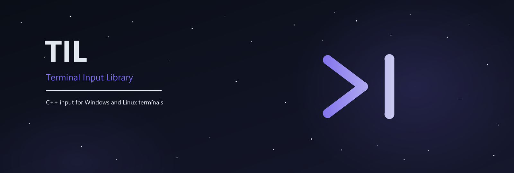

# TIL - Terminal Input Library



TIL is a C++ library for reading text, keyboard commands and mouse input in a
terminal on Windows and Linux. The whole library is in [TIL.hpp](TIL.hpp).
It needs C++11 or later and has no third-party dependencies.

This is source version **V1.1**, still in development. Some features depend on
the terminal. Text and commands can work even when full keyboard states are
not available.

TIL provides:

- Unicode text as UTF-8 strings.
- Events for text, keys, mouse input, focus and unknown terminal sequences.
- Nonblocking line input with partial text, Backspace and a custom ending.
- Real keyboard press and release states on supported backends.
- Optional mouse input with cell coordinates, three buttons and scrolling.
- Terminal mode restoration when the input session closes.

## Files

| File | Purpose |
| --- | --- |
| [TIL.hpp](TIL.hpp) | The complete library. Copy this file into your project. |
| [main.cpp](main.cpp) | A small example that reads text, Enter and Escape. |
| [README.md](README.md) | This guide and the public API reference. |
| [LICENSE](LICENSE) | The MIT license. |

All public types are in the `til` namespace. Examples use names such as
`til::Input` and `til::Key` directly. The library selects its Windows or Linux
backend internally, so your input code can use the same API on both systems.
A backend is the part of TIL that reads input from a particular system.

## Contents

- [1. Build and run](#1-build-and-run)
- [2. First example](#2-first-example)
- [3. Sessions and updates](#3-sessions-and-updates)
- [4. Options](#4-options)
- [5. Events and readers](#5-events-and-readers)
- [6. Reading lines](#6-reading-lines)
- [7. Keyboard states](#7-keyboard-states)
- [8. Mouse input](#8-mouse-input)
- [9. Capabilities](#9-capabilities)
- [10. The queue and errors](#10-the-queue-and-errors)
- [11. Paste and focus](#11-paste-and-focus)
- [12. Terminal sequences and timeouts](#12-terminal-sequences-and-timeouts)
- [13. Emergency cleanup](#13-emergency-cleanup)
- [14. Compatibility and implementation](#14-compatibility-and-implementation)
- [15. License](#15-license)

## 1. Build and run

To use TIL, copy `TIL.hpp` into your project and include it:

```cpp
#include "TIL.hpp"
```

There is no separate library to build or link. The following commands build
the included example from this folder.

### Windows with GCC or MinGW

In PowerShell:

```powershell
g++ -std=c++11 -Wall -Wextra -Wpedantic main.cpp -o main.exe
.\main.exe
```

### Windows with MSVC

In a Visual Studio developer command prompt:

```bat
cl /EHsc /std:c++14 /utf-8 main.cpp /Fe:main.exe
main.exe
```

MSVC has no `/std:c++11` option. C++14 or later is suitable.

### Linux or Ubuntu in WSL

```bash
g++ -std=c++11 -Wall -Wextra -Wpedantic main.cpp -o main -pthread
./main
```

TIL needs an interactive console or terminal. Initialization fails when
standard input (`stdin`) is a file or a pipe. An IDE output panel may use a
pipe; its integrated terminal or an external terminal is usually the right
place to run the program.

On Linux, input should use UTF-8. TIL returns UTF-8 on both systems. It does
not set the output encoding. The example calls `SetConsoleOutputCP(CP_UTF8)`
on Windows to display the returned text. Your terminal and font also affect
how accented letters and emoji appear.

## 2. First example

Run the example without arguments. Type `hello`, an accented letter or an
emoji. It prints `Text: ...` for each Unicode scalar it receives. Enter
prints a message, and Escape exits. Other events are read and ignored.

This is the full content of `main.cpp`:

```cpp
#include "TIL.hpp"
#include <iostream>

int main() {
#if defined(_WIN32)
    // On Windows, enable UTF-8 output.
    SetConsoleOutputCP(CP_UTF8);
#endif

    // 1. Open a terminal input session.
    til::Input input;
    if (!input.IsInitialized()) {
        std::cerr<<"Failed to initialize input.\n";
        return 1;
    }

    std::cout<<"Type something. Press Escape to exit."<<std::endl;

    while (true) {
        // 2. Wait for input and update available events.
        if (!input.Wait()) {
            std::cerr<<"Failed to read input.\n";
            return 1;
        }
        if (input.GetLastError() == til::InputError::QueueFull) {
            std::cerr<<"Queue full: some events were lost.\n";
        }

        // 3. Read events one at a time, in arrival order.
        til::InputEvent evento;
        while (input.GetEvent(evento)) {
            if (evento.type == til::InputEvent::Type::Text) {
                std::cout<<"Text: "<<evento.text<<std::endl;
            } else if (evento.type == til::InputEvent::Type::Key) {
                if (evento.key == til::Key::Escape) {
                    // Destroying input restores the terminal before returning.
                    return 0;
                }
                if (evento.key == til::Key::Enter) {
                    std::cout<<"You pressed Enter."<<std::endl;
                }
            }
        }
    }
}
```

The example has three main steps:

1. `til::Input input` opens a session. `IsInitialized()` checks the result.
2. `Wait()` waits for input and updates the events and states.
3. `GetEvent(evento)` reads one event at a time. A `Text` event holds UTF-8
   text. A `Key` event holds a command such as Enter or Escape.

The outer loop keeps the program running. The inner loop reads all queued
events. `return 0` exits when Escape arrives. When `input` is destroyed, it
tries to restore the terminal. This also happens on an early return after
an error. An explicit `Shutdown()` lets you check whether restoration worked.

The sections below explain the other readers, line input, keyboard states
and mouse input. Except for the full example above, code fragments show
parts of an application. They assume the needed standard headers and an
active `til::Input input`. Event and state reads follow `Update()` or `Wait()`.

## 3. Sessions and updates

An `Input` object owns a terminal input session. Its constructor tries to
initialize it straight away. The session stays open until `Shutdown()` or
the object's destruction.

| Member | Result and use |
| --- | --- |
| `explicit Input(const til::InputOptions& options = til::InputOptions())` | Creates the object and tries to open a session. |
| `~Input()` | Tries to close the session when the object leaves scope. |
| `bool Initialize(const til::InputOptions& options = til::InputOptions())` | Opens a session after a failed attempt or after shutdown. |
| `bool IsInitialized() const` | Reports whether this object has an active session. |
| `bool Update()` | Collects available input and updates the current states without waiting for a key. |
| `bool Wait(int timeoutMs = -1)` | Waits for input or a timeout, then updates input and states. |
| `bool ClearLine()` | Clears the partial line and its too-long state. It keeps queued events. |
| `bool ClearEvents()` | Empties the event queue. It keeps the partial line, input states and drop count. |
| `bool Shutdown()` | Closes the session and tries to restore the saved terminal modes. |

### Update or Wait

Use `Update()` when the application already has a regular loop. Use `Wait()`
when it can wait for input. `Wait()` performs the update itself, so there is
no need to call `Update()` immediately after it.

| Wait argument | Meaning |
| --- | --- |
| No argument or `-1` | No caller time limit. Internal input deadlines still apply. |
| `0` | Check input without waiting. |
| A positive number | Wait for up to that many milliseconds. |
| Less than `-1` | Invalid; returns false with `InvalidOptions`. |

Both methods return true for a successful update. This includes an idle
timeout and a `QueueFull` warning. A true result does not promise that there
is a public event, or that no input was lost. Check `GetLastError()` right
after the call, then read events and states.

An incomplete sequence or a native record can wake `Wait()` without creating
a public event. Linux waits also account for the parser's input deadlines.

One update is called a **frame** in this guide. It does not need to be a
graphics frame. `Pressed`, `Released`, mouse movement and wheel totals refer
to this frame and reset at the next update.

`Update()` handles at most 4096 native Windows records or 4096 Linux bytes per
call. Further input is left for later calls. On Linux, some control writes
during initialization and shutdown may wait up to 100 ms for writable output.
Event readers do not wait for more input.

### One owner and one input thread

A process can have one TIL session at a time, including across several `.cpp`
files. A second object reports `AlreadyInUse`. It keeps its own error and
does not read from or close the first object's session. It can call
`Initialize()` again after the terminal becomes free.

`Input` cannot be copied or moved. Pass it by reference when several functions
need the same session:

```cpp
void readEvents(til::Input& input) {
    til::InputEvent event;
    while (input.GetEvent(event)) {
        // Handle the event here.
    }
}
```

Keep the object alive while using a reference to it. Manage the session and
its readers from one thread. TIL does not synchronize public API calls.
Other threads may do unrelated work, but input ownership stays on that thread.

TIL needs exclusive use of the terminal input. While its session is open,
use TIL readers instead of `std::cin`, `std::getline(std::cin, ...)`, `getchar`,
`_getch`, ncurses or another input reader. To return to standard input, call
`Shutdown()` and check that it succeeds. Already consumed events are not put
back into the operating system's input queue.

### Reopening and cleanup

`Initialize()` on an active object returns true and keeps the current options
and data. To apply new options, call `Shutdown()` and then `Initialize(options)`.
A new session starts with empty events, line data, states and observed features.

An inactive object has empty capabilities, false state results and zero
positions and counts. Its simple readers return no event. `Update()`, `Wait()`
and `GetLine()` need an active session and can report `NotInitialized`.

`Shutdown()` makes the session inactive even when restoration fails. In that
case, `RestoreFailed` keeps the native error. You can retry `Shutdown()` or
`Initialize()`. Pending restoration keeps the terminal reserved while the
object is alive. A failed initialization can also leave cleanup to retry.

The destructor tries cleanup but cannot return its result. If it fails, the
internal backend can keep the restoration data for another `Input` object
to retry. Cleanup is also tried at normal process termination.

Calling `Shutdown()` on an already closed or rejected object returns true and
does not affect another owner. A successful backend cleanup clears its error;
a call on an already closed or rejected object keeps that object's diagnosis.

By default, shutdown keeps unread operating system input. Set
`discardPendingInputOnShutdown = true` to discard it, including typed text.
Input can still arrive after the native flush. A flush failure does not stop
the mode restoration attempt and can be retried. On Linux, permanently blocked
control output can give `RestoreFailed` with `ETIMEDOUT`.

## 4. Options

Set options before constructing `Input`, or pass them to `Initialize()` when
opening a new session:

```cpp
til::InputOptions options;
options.enableMouse = true;
options.lineCapacity = 4096;
til::Input input(options);
if (!input.IsInitialized()) return 1;
```

| Field | Default | Meaning |
| --- | --- | --- |
| `queueCapacity` | `4096` | Maximum queued events. It is an event count, not a byte count. Greater than zero. |
| `escapeTimeoutMs` | `30` | Linux delay for separating a legacy Escape key from an escape sequence. Also the CR/LF merge window. Zero or greater. |
| `enableMouse` | `false` | Enables terminal mouse input. |
| `mouseTracking` | `til::MouseTracking::AllMotion` | `Buttons`: clicks and scrolling; `Drag`: also movement with a button down; `AllMotion`: all reported movement. |
| `coalesceMouseMoves` | `false` | Combines consecutive Move events with matching button and modifiers. Keeps the last position and adds deltas, clamped to the integer range. |
| `prioritizeInput` | `true` | On overflow, an event other than Move can replace the oldest queued Move. |
| `lineCapacity` | `65536` | Maximum UTF-8 bytes in the partial line. Greater than zero. A Unicode scalar is never split. |
| `discardPendingInputOnShutdown` | `false` | Also discards unread native input during shutdown and emergency cleanup. |
| `preserveSignals` | `false` | Linux: keeps the original ISIG setting if it was enabled. Legacy Ctrl+C can then raise SIGINT. |
| `enableBracketedPaste` | `false` | Linux: saves, enables and later restores xterm paste mode 2004. |
| `enableFocusEvents` | `false` | Linux: saves, enables and later restores xterm focus mode 1004. |
| `enableKeyboardState` | `true` | Enables Windows key states and Linux state detection. False disables all five `IsKey...` queries. |
| `keyboardProtocolTimeoutMs` | `200` | Linux: positive time limit for each keyboard protocol reply or pending negotiation write. |
| `automaticRestore` | `false` | Enables process-wide emergency cleanup hooks. Normal destructor and shutdown cleanup do not need this option. |
| `sequenceTimeoutMs` | `1000` | Linux: positive inactivity limit for unfinished control strings, paste, UTF-8 and advanced/private sequences. |

Unknown `mouseTracking` values are invalid. The capacities and time limits are
checked when opening the session. A negative Escape timeout, or a zero or
negative protocol or sequence timeout, gives `InvalidOptions`.

Timeouts are processed by `Update()` and `Wait()`. The readers do not wait for
their own timeout. Windows uses native console key records rather than the
Linux sequence parser. Paste, focus, signal-preservation and protocol-timeout
options relate to the Linux backend; Windows uses its native input records.

## 5. Events and readers

### InputEvent

`til::InputEvent` is the common event type. Read the fields that match its
`type`:

| Field | Type | Meaning |
| --- | --- | --- |
| `type` | `til::InputEvent::Type` | `Text`, `Key`, `UnknownSequence`, `Mouse` or `Focus`. |
| `text` | `std::string` | One UTF-8 scalar for Text; original bytes for UnknownSequence. |
| `key` | `til::Key` | The command in a Key event. |
| `modifiers` | `til::InputModifiers` | Boolean `shift`, `ctrl` and `alt` flags. |
| `mouse` | `til::InputMouseEvent` | Mouse action, button, position, movement and scrolling. |
| `pasted` | `bool` | True for literal text from bracketed paste. |
| `focused` | `bool` | True for focus gained, false for focus lost, in a Focus event. |
| `truncated` | `bool` | An UnknownSequence was cut short by a size limit or inactivity deadline. |

An event starts as Text, with empty text, `til::Key::Unknown`, false modifier,
paste and truncation flags, and `focused = true`. Mouse data has its own
defaults, described in the mouse section.

A Unicode scalar is one Unicode value, stored in 1 to 4 UTF-8 bytes. It is
not always a whole visible character. A combined accent or an emoji made of
several values can produce several Text events. `std::string::size()` counts
bytes, not visible characters.

Ordinary letters, digits and spaces arrive as Text. Commands such as Enter,
Backspace and arrows arrive as Key. On Windows, TIL converts UTF-16 and handles
surrogate pairs across updates. On Linux, it joins incomplete UTF-8 input
across reads. Recognized malformed text becomes the replacement character
U+FFFD rather than a broken UTF-8 scalar.

`til::InputModifiers` contains `bool shift`, `bool ctrl` and `bool alt`, all
false by default. Their values follow the received report. An absent modifier
flag does not prove that a physical modifier key is up. Windows AltGr text can
have both Ctrl and Alt set; that text can still be ordinary printable input.

### Key values

These are the members of `til::Key`, in declaration order:

```text
Unknown = -1,
A, B, C, D, E, F, G, H, I, J, K, L, M,
N, O, P, Q, R, S, T, U, V, W, X, Y, Z,
Num0, Num1, Num2, Num3, Num4, Num5, Num6, Num7, Num8, Num9,
F1, F2, F3, F4, F5, F6, F7, F8, F9, F10, F11, F12,
Space, Enter, Escape, Tab, ArrowUp, ArrowDown, ArrowLeft, ArrowRight,
Shift, Ctrl, Alt, Backspace, Delete, Home, End, PageUp, PageDown, Insert,
Count
```

These are logical names, not physical key positions. `Unknown` is an unmapped
command. `Count` is the enum boundary and is not a key. The enum does not name
every physical key or every printable character.

Typing `a` normally gives Text containing `"a"`, rather than `til::Key::A`.
Ctrl+C can give a Key event with `key = til::Key::C` and `modifiers.ctrl = true`.
Use `GetEvent()` when modifier flags matter. `GetKey()` only returns the key.

### Reader functions

| Member | Result |
| --- | --- |
| `bool GetEvent(til::InputEvent& event)` | Removes the next event of any type, in queue order. False leaves the argument unchanged. |
| `bool GetChar(std::string& text)` | Removes the next Text event. False leaves the argument unchanged. |
| `std::string GetChar()` | Returns the next UTF-8 scalar, or an empty string if there is none. |
| `bool GetKey(til::Key& key)` | Removes the next Key event. False leaves the argument unchanged. |
| `til::Key GetKey()` | Returns the next command, or `til::Key::Unknown` if there is none. |
| `bool GetMouseEvent(til::InputEvent& event)` | Removes the next Mouse event. False leaves the argument unchanged. |

All readers use **one shared queue**. Reading an event removes it; another
reader will not receive a copy. They read already collected data and do not
read directly from the terminal.

Filtered readers such as `GetChar()` find the requested type and leave other
types in the queue. They keep the order within that type. `GetEvent()` keeps
the full order across all types.

For example, typing `a`, Backspace, `b` produces Text, Key, Text. Reading all
Text first separates the text from the editing command. `GetEvent()` is a
good choice for your own editor; `GetLine()` already handles basic line input.

The bool form of `GetKey()` can tell an empty key queue from a real Key event
whose value is Unknown. Simple readers keep the last error, including when
no matching event exists. Consuming events does not clear the current states.

### Choosing a reader

| Goal | Reader or query | What to keep in mind |
| --- | --- | --- |
| Input in full order, with modifiers | `GetEvent()` | Handle the event types your application uses. |
| Text one scalar at a time | `GetChar()` | Backspace is a separate command. |
| Arrows, Enter or function keys | `GetKey()` | Modifier information is not returned. |
| Complete lines and partial text | `GetLine()` | Let it read text and Backspace before other readers do. |
| A key held down | `IsKeyDown()` or `IsKeyHeld()` | Check `GetCapabilities().keyState`. |
| A key transition in this update | `IsKeyPressed()` or `IsKeyReleased()` | Several transitions can be summarized by one bool. |
| Mouse events in order with keyboard input | `GetEvent()` | Enable mouse input in the options first. |
| Only mouse events | `GetMouseEvent()` | Handle remaining keyboard and other events too. |

Even an application that uses only states still needs to drain the queue.
Otherwise, events stay there and can fill it. After a filtered reader, you
can use `GetEvent()` to handle the events left over.

### Small filtered examples

For text, inside your loop after an update:

```cpp
std::string character;
while (input.GetChar(character)) {
    std::cout<<"Text: "<<character<<std::endl;
}

til::InputEvent other;
while (input.GetEvent(other)) {
    // Handle commands and other events, including an exit key.
}
```

For commands, you can use this alternative:

```cpp
til::Key key;
while (input.GetKey(key)) {
    if (key == til::Key::ArrowLeft) {
        std::cout<<"Left arrow"<<std::endl;
    }
}

til::InputEvent other;
while (input.GetEvent(other)) {
    // Handle text and other events left in the queue.
}
```

These fragments are alternatives for different input tasks. Reading all events
with `GetEvent()` first would leave nothing for the filtered reader afterward.

## 6. Reading lines

`GetLine()` builds a line without waiting. The ending, called the terminator,
is Enter by default. Each valid call copies the current line into your string.
It returns true when it finds the terminator and leaves it out of the result.

The four overloads are listed below as reference signatures:

```cpp
bool GetLine(std::string& line, til::Key terminator = til::Key::Enter);
bool GetLine(std::string& line, const std::string& terminator);
bool GetLine(std::string& line, const char* terminator);
bool GetLine(std::string& line, char terminator);
```

These signatures describe members of `til::Input`. Call them on your object:

```cpp
std::string line;
input.GetLine(line);                    // Enter
input.GetLine(line, til::Key::Tab);      // Tab
input.GetLine(line, ' ');                // ASCII space
input.GetLine(line, ";");                // Semicolon
input.GetLine(line, std::string(";"));   // The std::string overload
input.GetLine(line, "\xc2\xa7");          // One UTF-8 scalar
```

These are alternative calls, rather than five independent line readers.
The partial line belongs to the session and is shared by all overloads.

### Complete and partial text

| Result | Value copied into `line` |
| --- | --- |
| False, with `NoError` | The current partial line, which may be empty. |
| True, with `NoError` | One complete line, without its terminator. |
| True or false, with `LineTooLong` | The stored prefix of a line that exceeded its limit. |
| False, with another error | The argument stays unchanged and no input is consumed. |

For example, after typing `A`, a call returns false and copies `"A"`. After
typing `B`, it returns false and copies `"AB"`. After Enter, it returns true
and copies `"AB"`. The next call starts the next line, so save a complete
line before calling again if you need to keep it.

This fragment runs after a successful `Update()` or `Wait()` and after
checking its queue warning:

```cpp
std::string line;
bool complete = input.GetLine(line);
til::InputError error = input.GetLastError();

if (error == til::InputError::LineTooLong) {
    // The prefix is available, but this line exceeded its limit.
} else if (error != til::InputError::NoError) {
    // Handle the error before using the result.
} else if (complete) {
    std::cout<<"Complete: "<<line<<std::endl;
} else {
    // line contains the text typed so far.
}
```

`Update()` alone does not change your external string. Call `GetLine()` to
copy the latest text. The external string is a copy; changing it does not
edit the internal partial line. Changing the terminator keeps the current
partial text. A new session or `ClearLine()` clears it.

One call stops at the first terminator. Call again to read further complete
lines already in the queue. Consecutive terminators can produce empty lines.
Check the error after each call, including calls that return true.

### Editing and event order

Backspace removes one Unicode scalar, without splitting UTF-8. It does
nothing on an empty line. A visible character made of several scalars can
take more than one Backspace. Choosing Backspace as the terminator makes it
finish the line instead.

`GetLine()` reads Text, Backspace and the selected terminator. Other keys,
Mouse, Focus and UnknownSequence events stay in the queue in their relative
order. Call it before readers that could remove its text or editing commands.
Then use `GetEvent()` to handle the remaining events, including an exit key.

For example, with space as the terminator, Enter stays a Key event and is not
added to the line. `GetLine()` does not print text, move the cursor or provide
editing with arrows, Delete or Home. Your application handles the display.
It also handles validation of the entered text. This is not a password-entry
or authentication function.

### Custom terminators

A text terminator is exactly one valid Unicode scalar in UTF-8. Use a string
for a multibyte scalar. A `char` only holds one byte. From C++20, `u8"..."`
literals use `char8_t` and cannot be passed directly to this API. A byte string
such as `"\xc2\xa7"` works with these overloads in C++11 and later.

`til::Key::Space` is an alias for the text `" "`. For a normal letter ending,
use `"a"`, rather than `til::Key::A`: typed letters normally arrive as Text.
A Key terminator matches the command without checking modifiers. Whether
that command is received depends on the backend, as it does with `GetKey()`.

These aliases work as either a character or a one-character string:

| Text value | Command |
| --- | --- |
| `\r` or `\n` | `til::Key::Enter` |
| `\t` | `til::Key::Tab` |
| `\b` or `\x7f` | `til::Key::Backspace` |
| `\x1b` | `til::Key::Escape` |

An empty string, `nullptr`, multiple scalars, malformed UTF-8, other ASCII
controls, `til::Key::Unknown`, `til::Key::Count` or an out-of-range key gives
`InvalidTerminator`. With no active session, the result is false with
`NotInitialized`. A valid call clears the previous diagnosis, except for an
ongoing `LineTooLong` condition. Read update warnings before calling it.

### Line length limit

`lineCapacity` limits **UTF-8 bytes**, not characters or screen columns. The
default is 65536 bytes, or 64 KiB. A line exactly at the limit is still valid.
The error starts when another scalar no longer fits in full.

Once that happens, TIL keeps the existing prefix and reports `LineTooLong`.
It discards later Text and Backspace events until the actual chosen terminator.
Even a shorter character that could fit is discarded. It does not generate
an automatic Enter or carry the remaining text into the next line. Other
events, such as mouse input or function keys, remain available to their readers.

Before the terminator, `GetLine()` returns false with `LineTooLong`. At the
terminator, it returns true with the same error and the stored prefix. The
next line starts empty with a clear length state. A pasted terminator is
literal text and does not finish the line. Backspace works normally before
the first rejected scalar and is ignored after it.

`ClearLine()` explicitly cancels the partial text and this discard state. It
keeps events that are already queued. `ClearEvents()` empties only the queue;
it does not cancel an overlong line. The next `GetLine()` reports its length
error again. Check `LineTooLong` before treating a returned line as a command.

On Linux, CR followed by LF produces one Enter when LF is observed within
`escapeTimeoutMs` of CR. This works across reads. A later LF is another Enter;
two CR bytes or two LF bytes still produce two Enter commands.

## 7. Keyboard states

These queries describe real key states from a supported backend:

| Member | Meaning |
| --- | --- |
| `bool IsKeyPressed(til::Key key) const` | A new press was observed in the current frame. |
| `bool IsKeyDown(til::Key key) const` | The latest received state is down. |
| `bool IsKeyUp(til::Key key) const` | A valid key is not down, when key states are available. |
| `bool IsKeyReleased(til::Key key) const` | A release was observed in the current frame. |
| `bool IsKeyHeld(til::Key key) const` | The key is down in both the previous and current frame. |

When `GetCapabilities().keyState` is false, **all five queries return false**,
including `IsKeyPressed()` and `IsKeyUp()`. Here, false means that the query
is unavailable. It does not describe the physical key. Event and line readers
still work. Inactive sessions and invalid key values also give false.

Pressed and Released reset on each update. Key repeat may produce text or
commands without creating another Pressed transition. A press and release
in one update can make both flags true, with Down false at the end. Held
compares two frames; it does not measure how long the key was pressed.
Reading or clearing events does not clear these frame states.

### Available backends

| Environment | Key state source |
| --- | --- |
| Windows native console | Console key records. |
| Linux terminal with the required kitty keyboard modes confirmed | Press, repeat and release reports from the terminal. |
| Local Linux virtual console with accessible devices | evdev keyboard state. |
| A terminal without either source | Full key states are unavailable. |

TIL does not simulate release with a timer. It checks protocol replies rather
than guessing from the terminal name or `TERM`. With SSH, support also depends
on the client terminal and any terminal multiplexer in between.

Linux detection runs during ordinary `Update()` and `Wait()` calls. While
`keyStatePending` is true, detection is still running. Each phase uses
`keyboardProtocolTimeoutMs`, including a pending write. There are two expected
replies. A slow connection may need a longer timeout. No reply, or only partial
support, leaves key states unavailable without failing normal text input.

For the kitty backend, TIL saves the original flags, requests flags 31, and
checks event types, all keys and associated text. It handles CSI-u and
functional CSI forms with event types. Releases update states without
duplicating text or command events. The original modes are restored on
shutdown, also after partial confirmation or a timeout.

Keyboard protocol state belongs to the terminal screen where it was enabled.
If you use an alternate screen, open `Input` after entering that screen and
close it before leaving. Reopen the session when changing screens outside TIL.

For local Linux virtual consoles, TIL checks the console with native ioctls.
It reads up to 16 accessible evdev keyboard devices. It does not change their
permissions or take exclusive device ownership. It does not open evdev from
a PTY, SSH session or ordinary WSL terminal.

The local console key map is read at initialization; a PC mapping is used if
that map cannot be read. Text still comes from standard input with its layout
and composition. Left and right modifiers, and several keyboards, are combined.
Console switching releases the old states and resynchronizes on return. Lost
device events and removed devices are handled. Reopen the session to discover
newly connected keyboards or to reload the console key map.

The selected backend is available in `InputCapabilities::keyboardBackend`:
`til::KeyboardBackend::Unavailable`, `WindowsConsole`, `Kitty` or `LinuxConsole`.
With `enableKeyboardState = false`, all five queries are disabled, including
on Windows. Events remain readable.

For example, inside your loop, after an update:

```cpp
til::InputCapabilities capabilities = input.GetCapabilities();
if (capabilities.keyState) {
    if (input.IsKeyDown(til::Key::ArrowLeft)) {
        // Move left while the key is down.
    }
    if (input.IsKeyReleased(til::Key::ArrowLeft)) {
        // Handle the release in this update.
    }
} else if (!capabilities.keyStatePending) {
    // Use event-based controls when full states are unavailable.
}

til::InputEvent event;
while (input.GetEvent(event)) {
    // Handle events, including any command that exits the application.
}
```

Focus loss releases states when the host sends a focus report. Missing reports
cannot be reconstructed. Unicode text belongs in text readers; the Key enum
is a limited set of logical names.

## 8. Mouse input

Enable mouse input before opening the session:

```cpp
til::InputOptions options;
options.enableMouse = true;
options.mouseTracking = til::MouseTracking::AllMotion;
til::Input input(options);
if (!input.IsInitialized()) return 1;
```

`til::MouseButton` has `Unknown = -1`, `Left`, `Right`, `Middle` and `Count`.
Unknown means no mapped button. Count is the enum boundary. Side buttons
X1 and X2 are outside the API.

`til::Vec2` contains two `int` fields, `x` and `y`. A mouse position is a
column and row in terminal cells, starting at `(0, 0)` in the top-left corner.
It is not a desktop or pixel coordinate.

### Mouse event data

Read mouse data from `event.mouse` in a Mouse event. Modifier flags remain in
`event.modifiers`.

| Field of `til::InputMouseEvent` | Meaning |
| --- | --- |
| `action` | `til::InputMouseEvent::Action::Move`, `Press`, `Release` or `Scroll`. |
| `button` | The related button, or `til::MouseButton::Unknown`. |
| `position` | The reported terminal cell. |
| `delta` | Cell movement since the previous received native mouse record. Zero for the first position. |
| `wheel` | Horizontal scrolling in x and vertical scrolling in y. |

Default mouse data is Move, Unknown and zero position, delta and wheel values.
The wheel uses 120 units per conventional notch: positive x is right, positive
y is up. Windows keeps the received amount, including partial notches. Each
Linux SGR wheel report represents one notch.

### Mouse queries

| Member | Result |
| --- | --- |
| `bool GetMouseEvent(til::InputEvent& event)` | Reads the next Mouse event from the shared queue. |
| `bool HasMousePosition() const` | At least one valid position has been observed in the active mouse session. |
| `til::Vec2 GetMousePosition() const` | Last known position. Initially `(0, 0)`. |
| `til::Vec2 GetMouseDelta() const` | Total movement in the current update. |
| `til::Vec2 GetMouseWheel() const` | Total scrolling in the current update. |
| `bool IsMouseButtonPressed(til::MouseButton button) const` | A new press was observed in this update. |
| `bool IsMouseButtonDown(til::MouseButton button) const` | Latest reported state is down. |
| `bool IsMouseButtonUp(til::MouseButton button) const` | The button has been observed in this session and is now up. |
| `bool IsMouseButtonReleased(til::MouseButton button) const` | A release was observed in this update. |
| `bool IsMouseButtonHeld(til::MouseButton button) const` | Down in both the previous and current update. |

Check `HasMousePosition()` before relying on the first position. Movement and
wheel totals reset on each update; the last position remains. Event fields
keep their own movement and wheel amounts. A Windows record can create several
events; its movement belongs to the first one so that it is not counted twice.

Button queries return false if mouse input is disabled, the session is inactive
or the button is invalid. An unobserved button does not count as Up. These
states can update even when the event queue is full or the events are consumed.
Mouse states do not require full keyboard states.

For example, after an update:

```cpp
if (input.HasMousePosition()) {
    til::Vec2 position = input.GetMousePosition();
    std::cout<<"Position: "<<position.x<<", "<<position.y<<std::endl;
}

til::InputEvent event;
while (input.GetMouseEvent(event)) {
    // Read event.mouse.action, button, position, delta and wheel.
}
while (input.GetEvent(event)) {
    // Handle the non-mouse events left in the queue.
}
```

### Platform details

Windows uses native console mouse records and temporarily disables Quick Edit.
Buffer positions are converted to the visible terminal window. Releases outside
that window are kept at the last valid position with zero movement; other
outside records are ignored. There is no portable DoubleClick event: Windows
still uses press and release transitions.

Linux needs SGR mouse mode 1006, the selected tracking mode 1000, 1002 or 1003,
and private-mode save/restore support through XTSAVE/XTRESTORE. TIL saves the
modes, disables incompatible mouse modes, enables the requested ones and tries
to restore them on shutdown. SGR coordinates starting at 1 are converted to 0.

Mouse protocol support is not negotiated. Successful initialization alone
does not confirm it. A terminal may keep Shift+click for text selection.
An SGR drag can observe a button without inventing an earlier press. X10,
legacy UTF-8 mouse, urxvt mouse and pixel coordinates are not decoded.

## 9. Capabilities

`til::InputCapabilities GetCapabilities() const` returns a copy of the current
capabilities. Some fields describe enabled input features; others describe
reports already observed during this session.

| Field | Meaning |
| --- | --- |
| `text` | True in an active session. |
| `specialKeys` | True in an active session; it does not promise every key combination. |
| `keyState` | Full key states are available and enabled. |
| `keyStatePending` | Linux keyboard detection is still running. False on Windows. |
| `keyboardBackend` | `til::KeyboardBackend::Unavailable`, `WindowsConsole`, `Kitty` or `LinuxConsole`. |
| `mouse` | Mouse input was enabled for the active session. Linux protocol support still depends on the terminal. |
| `mouseButtons` | An unsigned bit mask of buttons observed in this session. |
| `mouseVerticalWheel` | At least one vertical wheel report was observed. |
| `mouseHorizontalWheel` | At least one horizontal wheel report was observed. |

On Windows, keyState uses native console records when `enableKeyboardState`
is true. On Linux, it becomes true with confirmed kitty support or an available
local console backend. An inactive session has false and zero fields and the
Unavailable backend.

The button mask uses `1u<<int(button)`: Left is 1, Right is 2 and Middle is 4.
Use only valid buttons for that shift. The observed mouse features are not a
promise about the hardware. They accumulate during the session.

## 10. The queue and errors

### Counts and diagnostics

| Member | Result |
| --- | --- |
| `std::size_t PendingEvents() const` | Events still in TIL's queue. |
| `std::size_t DroppedEvents() const` | Events discarded because the queue filled during this session. |
| `til::InputError GetLastError() const` | The object's last recorded error or warning. |
| `unsigned long GetNativeError() const` | The related Win32 error, Linux errno or interruption reason, or zero. |

`PendingEvents()` does not count unread operating system input, unfinished
parser data or text already moved into the partial line. Events stay queued
across updates until a reader consumes them or `ClearEvents()` removes them.
`queueCapacity` is an event limit; `lineCapacity` is a separate byte limit.

### A full queue

With `prioritizeInput = true`, a new event other than Move can replace the
oldest queued mouse Move. If no Move can be removed, the new event is dropped.
With the option false, already queued events are kept and the new event is
dropped. The relative order of surviving events stays the same.

Mouse move coalescing is separate and optional. It combines matching,
consecutive moves, so intermediate positions are deliberately lost. This
does not count as dropping an event.

If an update drops events, `Update()` and `Wait()` return **true** with
`GetLastError() == til::InputError::QueueFull` and native error zero. The
session stays active. `DroppedEvents()` includes removed Moves as well as
new events that could not be kept.

Check the warning immediately after the update, before a call such as
`GetLine()` or `ClearEvents()` can clear it:

```cpp
if (!input.Wait(8)) {
    std::cerr<<"Input failed. Error: "<<int(input.GetLastError())<<", native: "<<input.GetNativeError()<<std::endl;
    return 1;
}
if (input.GetLastError() == til::InputError::QueueFull) {
    std::cerr<<"Dropped events: "<<input.DroppedEvents()<<std::endl;
}

til::InputEvent event;
while (input.GetEvent(event)) {
    // Handle the events that were kept.
}
```

A later update without new drops can report `NoError` while the queue is
still full and the drop count is greater than zero. The count is cumulative
for the session and resets on shutdown or a new session.

States can update even if their events do not fit. A line reader may lose
text, Backspace or its terminator during overflow. The application decides
whether to keep the surviving input, clear the current command or request
new input. A finite queue cannot keep every event under unlimited load.
If a read or restore error also occurs, it takes priority: the update returns
false with that error rather than the queue warning.

### InputError values

| Value | Meaning |
| --- | --- |
| `NoError` | No error in the last operation that reset the diagnosis. |
| `NotInitialized` | This operation needs an active session. |
| `InvalidOptions` | A capacity is zero, a time limit or tracking value is invalid, or Wait received a value below -1. |
| `NotTerminal` | Standard input is not an available terminal or console. |
| `ConfigureFailed` | Opening resources or setting terminal modes failed. |
| `ReadFailed` | Input reading failed and cleanup was attempted. |
| `RestoreFailed` | Terminal restoration or pending-input cleanup failed. It can be retried. |
| `QueueFull` | Some events were dropped. Update and Wait still return true. |
| `InvalidTerminator` | The GetLine terminator is not valid. |
| `AlreadyInUse` | Another object owns the session or still has restoration to finish. |
| `LineTooLong` | A scalar did not fit in the line. The prefix is kept and later text is discarded until its terminator or ClearLine. |
| `Interrupted` | Emergency cleanup took place and ordinary Update or Wait finished closing the session. |

The constructor records the initialization result. Each object has its own
error: a second object's failure does not change the active owner's diagnosis.
A native error can be zero even when `GetLastError()` reports an error.

### When the diagnosis changes

Read diagnostics soon after the operation you want to check:

- An active `Update()` or `Wait()` starts a new update diagnosis.
- Opening a new session starts a new diagnosis. `Initialize()` on an already
  active object keeps the current one.
- A valid `GetLine()` clears the old diagnosis, even for an incomplete line,
  except for the length error still attached to an overlong line.
- Successful `ClearLine()`, `ClearEvents()` and backend restoration clear it.
- Simple event readers, state queries, capabilities and count queries keep it.

`NoError` is not a record of the whole session's history. Keep a copy of an
error and its native code if you need them after another operation.

A native read failure triggers shutdown and clears the input data. If that
cleanup succeeds, the result is `ReadFailed` with the read error. If cleanup
fails, the result is `RestoreFailed` instead.

## 11. Paste and focus

### Bracketed paste

On compatible Linux terminals, `enableBracketedPaste = true` requests mode
2004. Paste markers are recognized even if the application enabled that mode
before TIL. Text inside the markers has `pasted = true` and is treated literally.

Pasted Enter, Backspace, Ctrl+C and arrow sequences are not commands.
`GetLine()` includes the pasted controls as text; a pasted terminator does not
complete a line. Input may therefore contain control bytes as well as printable
text. The application chooses how to validate and display it.

Windows native records do not mark a whole paste block, so `pasted` does not
provide the same distinction there.

### Focus changes

A Focus event uses `focused = true` for focus gained and false for focus lost.
When a loss report is received, TIL releases observed keys and mouse buttons,
keeping their Released transitions in that update.

Windows handles native `FOCUS_EVENT` records when the console host provides
them. On Linux, `enableFocusEvents = true` requests xterm mode 1004. Delivery
depends on the host. If no report arrives, TIL cannot infer the focus change
or a missing key release.

The library reads input for the program's terminal. It does not provide global
desktop input, pointer movement commands or pixel positions. Cursor drawing,
cursor visibility and text rendering belong to the application.

### Ctrl+C and signals

By default, Ctrl+C is input for the application to handle. The small example
uses Escape to exit. For a Ctrl+C command, use `GetEvent()` and check both
`event.key == til::Key::C` and `event.modifiers.ctrl`.

On Linux, `preserveSignals = true` keeps the original ISIG setting. If it was
enabled, legacy Ctrl+C can raise SIGINT. With kitty keyboard reporting, Ctrl+C
arrives as an encoded event instead. If you use your own signal handlers,
arrange normal-flow cleanup or choose the optional emergency cleanup below.

## 12. Terminal sequences and timeouts

This section covers the Linux parser. Windows keyboard input uses native
records and UTF-16 conversion instead.

### Commands and Escape

TIL reads ASCII controls, CSI and SS3 commands for navigation and F1-F12,
Shift+Tab, xterm modifier forms, and Linux virtual-console forms for F1-F5.
An Escape byte followed by text may represent Alt+text.

Legacy terminals can send the same bytes for different keys. Examples include
Ctrl+I and Tab, Ctrl+M and Enter, Ctrl+H and Backspace, or Escape followed by
text and Alt+text. Standalone modifier events are not generally available.

`escapeTimeoutMs` separates an isolated Escape from a legacy sequence.
A longer timeout allows more time between bytes but can delay Escape.
Prefixes such as ESC followed by `[` or `O` become Alt+text if no further
bytes complete them before the deadline. An extra ESC before a recognized
CSI or SS3 command marks that command as Alt, also across fragmented reads.

TIL checks deadlines during updates and before adding a later read to a saved
prefix. Bytes first collected together may still be interpreted as Alt+text:
TIL does not know the exact typing time of each byte. Escape delivery can take
the timeout plus the interval until the next update.

With kitty confirmed, fragmented protocol input uses `sequenceTimeoutMs`
instead of the legacy Escape limit. Further bytes renew the inactivity period.
A raw, isolated ESC then uses that limit; a complete kitty Escape report can
be delivered straight away. Private sequences during negotiation also have
an inactivity limit, in addition to the negotiation phase limits.

### Unknown and unfinished sequences

A complete unsupported CSI or SS3 sequence becomes UnknownSequence. For
diagnostics, its length or a hexadecimal dump is useful. Printing the raw
bytes back to a terminal can make the terminal interpret them as commands.

OSC, DCS, APC, PM and SOS control strings are grouped into UnknownSequence
until ST; OSC also accepts BEL. CAN and SUB end the string early. At most
4096 raw bytes are kept. Longer strings set `truncated = true` and discard
the rest until the ending, rather than treating that rest as typed text.

In legacy input, an isolated ESC followed by `]`, `P`, `_`, `^` or `X` can become
Alt+text at the Escape deadline. With further bytes, it is read as a control
string. This follows the same ambiguity as other legacy Escape sequences.

After `sequenceTimeoutMs` without new observed bytes:

- An unfinished control string or advanced/private sequence is delivered as
  UnknownSequence with `truncated = true`, and ordinary parsing resumes.
- An unfinished paste block ends. Delivered text keeps `pasted = true`.
  An UnknownSequence with `truncated = true` contains its opening marker and
  any saved part of the closing marker. Marker fragments do not become commands.
- An unfinished UTF-8 scalar produces one U+FFFD replacement character. In
  paste, it keeps `pasted = true`.

`Wait()` respects these deadlines without new input. Time is measured from
when TIL observes bytes, rather than when they reached the operating system.
Long pauses on a slow connection may need a larger timeout. Continuous new
bytes keep renewing an inactivity deadline, so it is not a total-duration limit.

There is no general terminal-query response decoder. For example, a cursor
position reply and Ctrl+F3 can both use `ESC[1;5R`. If your application sends
terminal queries, it also needs to track their replies and context.

On Windows, Unicode control input without a known virtual key, such as
VK_PACKET or code zero, is normalized: CR/LF become Enter, Tab stays Tab,
BS/DEL become Backspace and ESC becomes Escape. Letter control codes become
the related Ctrl command. Synthetic text can create an event without a matching
physical state transition, so it does not by itself guarantee `IsKeyPressed()`.

## 13. Emergency cleanup

Normal destruction and `Shutdown()` already try to restore the terminal.
`automaticRestore` is false by default. It controls a separate, optional
attempt to restore modes when normal C++ object cleanup does not run.

To enable it before opening the session:

```cpp
til::InputOptions options;
options.automaticRestore = true;
til::Input input(options);
if (!input.IsInitialized()) return 1;
```

This option installs temporary process-wide hooks. Leaving it false avoids
those hooks, console callbacks, exception filters and signal-stack changes.
This is useful when your application already handles these paths itself.

| Path | Cleanup attempt |
| --- | --- |
| `std::terminate`, including an uncaught C++ exception | Restore before calling the previous terminate handler. |
| `std::abort` | Through SIGABRT, when the handler has not been ignored or replaced. |
| Linux signals | SIGINT, SIGTERM, SIGHUP, SIGQUIT, SIGABRT, SIGSEGV, SIGILL, SIGFPE, SIGBUS and SIGPIPE. |
| Windows CRT signals | SIGABRT and SIGTERM. |
| Windows console events | CTRL_C_EVENT, CTRL_BREAK_EVENT, CTRL_CLOSE_EVENT, CTRL_LOGOFF_EVENT and CTRL_SHUTDOWN_EVENT, then continue the handler chain. |
| Windows unhandled native exceptions | Restore from the SEH filter, then delegate to the previous filter. |
| `std::quick_exit` | A cleanup callback where the C++ runtime provides it. |

Emergency cleanup also follows `discardPendingInputOnShutdown`. When that
option is true, it tries to discard unread native input as well.

### Continuing after a handler

If a previous application handler returns and execution continues, the
terminal has already been restored. `IsInitialized()` becomes false and old
input data is no longer exposed. The next `Update()` or `Wait()` finishes
cleanup in normal C++ flow and returns false with `Interrupted`.

`GetNativeError()` reports the signal, Windows exception code or
ERROR_OPERATION_ABORTED for a console event. If cleanup fails, `RestoreFailed`
takes priority and shutdown can be retried. `Wait()` can also be woken by a
handled signal on another thread. After dealing with the cause, call
`Initialize()` to open a new session.

When your application uses these signals to recover and continue, especially
SIGSEGV or SIGPIPE, keeping `automaticRestore = false` may fit that design
better. `Shutdown()` itself uses normal C++ operations and is not suitable
for a raw signal handler. With your own handlers, request cleanup from the
normal application flow instead.

### How the hooks are kept separate

The emergency path uses saved modes, duplicated handles or file descriptors
and prepared restoration commands. It does not call `Shutdown()`, allocate
memory or edit C++ queues and strings in a signal handler. Shared flags use
lock-free atomics. Writes are nonblocking, interrupted attempts are bounded,
and Linux still tries to restore termios if control commands cannot be written.
SIGTTOU is blocked only while restoring Linux terminal modes.

On Linux, TIL reuses an existing alternate signal stack or creates one of at
least 64 KiB on the thread opening the session. A protected crash in a forked
child does not restore the terminal owned by the parent process.

Ignored signals stay ignored. Previous Linux handlers receive the original
signal details and context, with their masks and one-shot behavior preserved.
Default signal termination keeps its signal result. Hooks are restored on
close without replacing newer application handlers. The quick-exit callback
is registered once and acts only for a protected session.

Set up the session and change related handlers on the owner thread. Concurrent
handler changes are not supported. Later handlers that replace TIL's hooks
without delegating can bypass the cleanup attempt.

### Limits

Emergency cleanup is an attempt, not a guarantee for every stop or crash.
SIGKILL, SIGSTOP, `_Exit`, `_exit`, TerminateProcess, fast-fail, power loss or
some system shutdown paths can skip callbacks. Corrupted memory, an unusable
stack, a debugger or an earlier exception filter can also prevent cleanup.
Windows close and logoff callbacks have operating system time limits.

A disconnected terminal cannot be restored. Permanently blocked output can
prevent mouse, focus or keyboard protocol commands from arriving, even when
Linux termios restoration succeeds.

## 14. Compatibility and implementation

### Supported environments

| Environment | Text and commands | Full keyboard states |
| --- | --- | --- |
| Windows with standard input attached to a native console | Supported. | Native console records when enabled. |
| Linux interactive UTF-8 terminal | Supported for the documented input sequences. | Confirmed kitty support, otherwise unavailable. |
| WSL or SSH | Uses the Linux backend's rules. | Depends on the terminal and protocol; WSL alone does not add release reports. |
| Local Linux virtual console | Console text and commands. | evdev when the keyboard devices are accessible. |
| macOS, BSD and other systems | Not supported; compilation reports an error. | Unavailable. |
| Input from a file or pipe | Initialization is rejected. | Unavailable. |

PowerShell, CMD and Bash are shells. The console or terminal that hosts the
shell also matters. Mouse, focus and paste support have the requirements
described in their sections. Successful initialization does not certify every
terminal protocol. Check the capabilities and try the features you need in
the terminal where the application will run.

### Common questions

| Situation | Explanation or next step |
| --- | --- |
| Initialization gives NotTerminal in an IDE | Run in an integrated or external terminal with a real console or TTY. |
| Accented text looks wrong | Check UTF-8 output and the terminal font. The Windows example sets the output code page. |
| Backspace does not edit text read with GetChar | It is a Key event. Use GetLine for basic line editing, or handle it through GetEvent. |
| GetKey does not return a typed letter | Ordinary letters are Text events. Use GetChar or GetEvent. |
| IsKeyDown and IsKeyUp are both false | Check keyState and keyStatePending. All key queries return false without state support. |
| WSL reports no keyboard states | Text and commands can still work; full states need a compatible terminal protocol. |
| Mouse reports do not arrive on Linux | Check enableMouse and the terminal's SGR tracking support. |
| Input events disappear when using two readers | The readers share one queue and consume events. |
| A line stops accepting text | Check LineTooLong. Finish it with the real terminator, or use ClearLine to reset it. |
| Update or Wait returns true but reports QueueFull | It is a recoverable warning. Read the drop count and decide how to handle incomplete input. |

### How the header works

`Input` owns the session and saves the original terminal modes. `Update()`
collects input, converts it into events and updates states. Readers consume
that stored input. `Shutdown()` restores modes and closes private resources.

Windows uses native console APIs and a UTF-16 decoder. Linux duplicates
standard input and uses termios, poll and read. A parser joins UTF-8 and terminal
sequences across reads. Keyboard state detection runs without blocking the
ordinary update loop; local console states use evdev when available.

The definitions are inline or inside classes, so the header can be included
in several `.cpp` files. Only `til::Input` and the public types documented here
are the application API. `til::input_detail` is private and can change.

On Linux, TIL does not include `linux/input.h`, `linux/kd.h`, `linux/keyboard.h`
or `linux/vt.h`. It uses private UAPI definitions and does not add their KEY_*,
BTN_*, EV_*, KD*, KT* or VT* macros. Existing application macros are kept. Your
application can include those system headers before or after TIL if needed.
The no-error value is `til::InputError::NoError`, which also avoids Xlib's
`None` macro.

### Earlier API versions

This version uses an object. Replace older static calls such as
`Input::Update()` with `input.Update()`, and replace `InputSession` with the
life of the `Input` object. Use the `til::` prefix for public types.
The old `InputError::None` value is now `til::InputError::NoError`.

Code upgrading from earlier behavior also needs to account for these points:

- QueueFull is checked after a successful update, rather than only in its
  false branch. The default queue policy prioritizes input over mouse moves.
- All five key-state queries need `keyState = true`, including IsKeyPressed.
- The partial line has a default 64 KiB limit and discards excess input until
  the real terminator after the first scalar that does not fit.
- Emergency hooks are opt-in through `automaticRestore = true`.

### Scope of checks

Development checks included GCC/MinGW and MSVC on Windows x64, and GCC on
Ubuntu x64 in WSL, including automatic tests with private PTY terminals.
Input was also tried manually on Windows from PowerShell. Full keyboard states
were unavailable in the WSL terminal that was tried; normal text and commands
remain usable in that case.

These checks do not cover every terminal, keyboard layout or architecture.
Raspberry Pi, ARM and 32-bit targets are not declared verified. Parser tests
with synthetic mouse reports check decoding, rather than hardware delivery in
every terminal. This folder is the minimal source distribution; it does not
include the development test suite.

## 15. License

TIL is available under the [MIT license](LICENSE). It allows use, modification
and distribution, including commercial use, with the required copyright and
license notices. The software is provided without warranty. See `LICENSE`
for the full terms.
